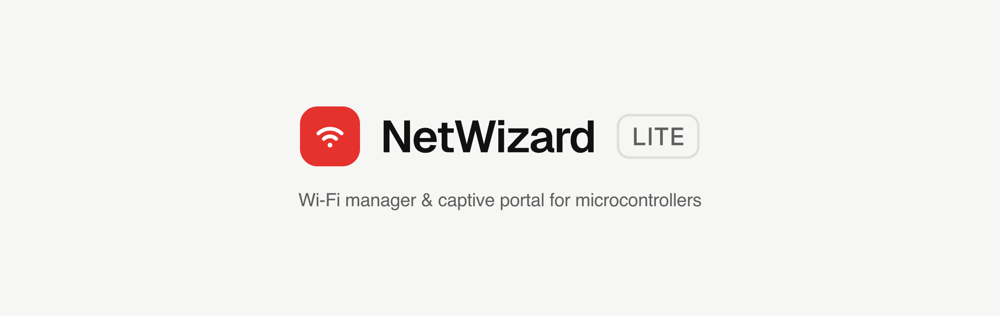
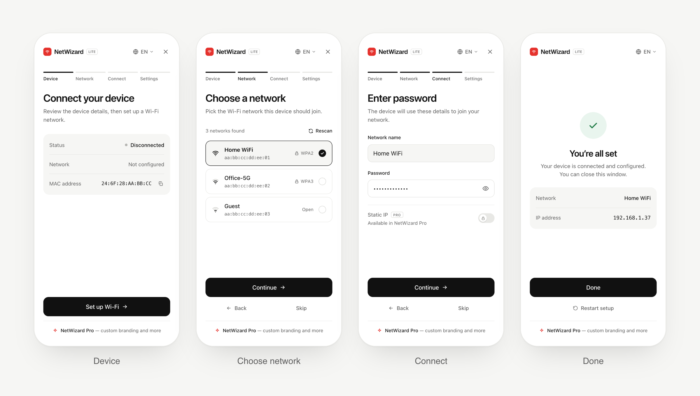
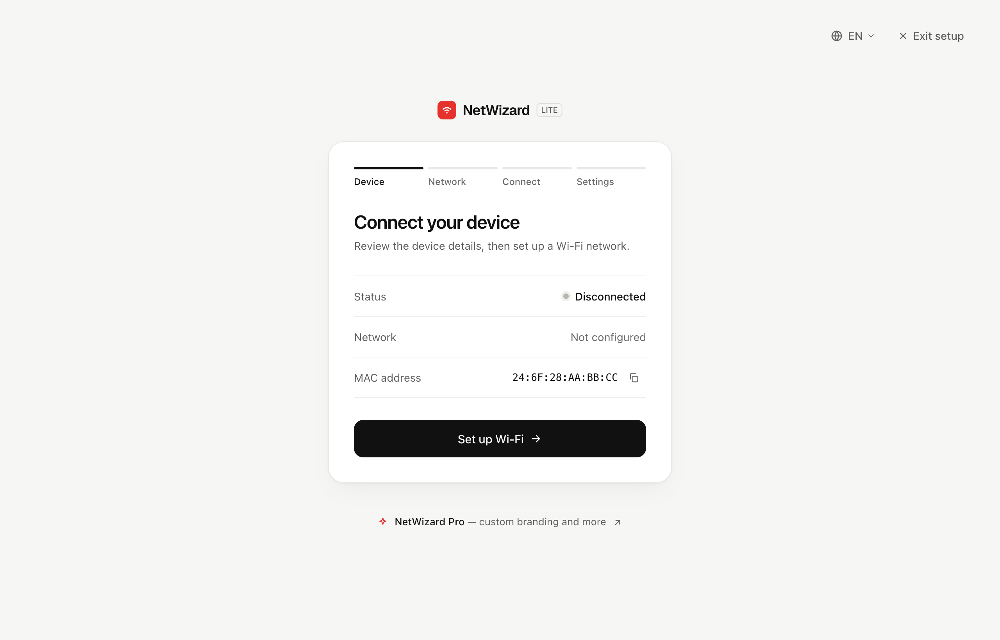
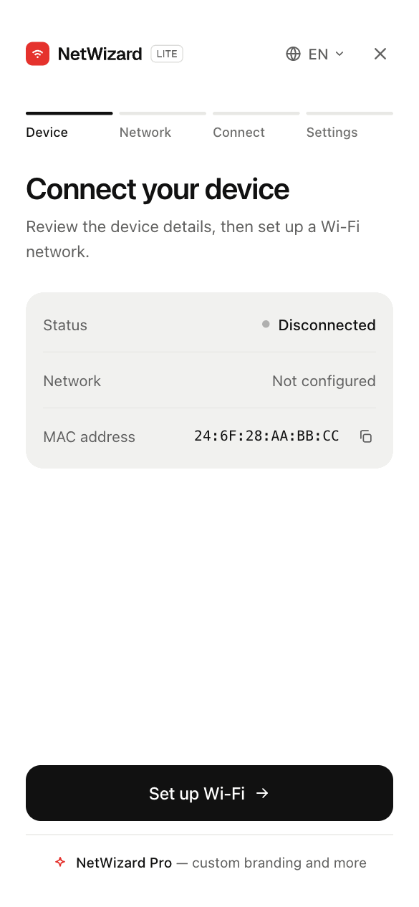
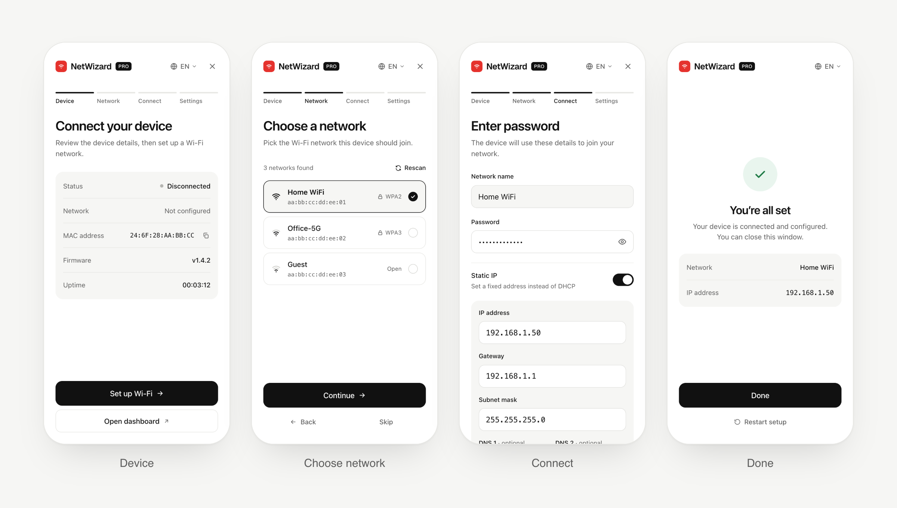

<p align="center"><a href="https://netwizard.pro?ref=ghfeature" target="_blank"></a></p>
<br/>
<p>

&nbsp;

&nbsp;

</p>
<br/>

<b>NetWizard</b> is a user-friendly yet robust WiFi manager and captive portal library for wireless microcontrollers. Eliminate the trouble of hard-coding WiFi credentials by letting NetWizard handle the networking for your device!

Additionally, NetWizard lets you create a custom configuration page of your choice which is shown at the time of setup. The possibilities are endless!

<br/>

## Features

- 🛜 No hard-coded WiFi credentials
- ⚙️ Create a custom configuration page using just C++
- ⚡ Intuitive step-by-step setup flow which makes user interaction easier
- 📱 Responsive portal, full-screen on phones and a focused card on desktop
- 🌐 Available in 12 languages (with right-to-left support) and a language picker for your users
- 📍 Shows the device's network and IP address once it's connected
- 🎷 No need to learn HTML/CSS/JS
- 🛫 Ready to use within 4-5 lines of code

<br/>

## Supported MCUs

NetWizard works on the following microcontrollers/boards:

- ESP32
- RP2040 + W (Pico W etc.)
- RP2350 + W (Pico 2W etc.)
- *( more coming soon )*

<br/>

<h2>Documentation</h2>
<p>Learn more about Installation & Usage: <a href="https://docs.netwizard.pro?ref=gitreadme">Click Here</a></p>

<br>

<h2>OSS Preview</h2>
<p>Once you have integrated NetWizard library in your code, you can connect to your device's AP and then this captive portal will pop up for you to configure your device:

<br/>
<br/>



<br/>
<br/>

On a laptop or desktop, the same steps appear in a centered card:

<br/>
<br/>



<br/>
<br/>

## Portal Language

The portal is translated into English, Spanish, French, German, Portuguese, Italian, Russian, Chinese, Japanese, Korean, Arabic and Hindi. By default it follows the language of the visitor's browser, and visitors can switch it from the language picker next to the close button.

<p align="center"></p>

To choose the default language yourself, call `setLanguage()` before `autoConnect()`:

```cpp
NW.setLanguage("hi"); // en, es, fr, de, pt, it, ru, zh, ja, ko, ar or hi
```

A language the visitor picks is remembered on their device and takes priority over this default.

<br/>

## Looking for more? Upgrade to Pro

Netwizard Pro comes with the following extended functionality:

- Static IP configuration (set from code or by your users in the portal)
- Exclusive Parameters (Password Input, Toggle and more)
- Links
- Statistics
- Whitelabel / Branding
- UI Source
- Softt Commercial License 1.3

<br> <b>Available here: </b>

- [Official Website ( netwizard.pro )](https://netwizard.pro?ref=ghrepo)

<br/>

<a href="https://netwizard.pro?ref=ghpropreview" target="_blank">
  
</a>

<br>
<br>

<h2>Contributions</h2>
<p>Every contribution to this repository is highly appreciated! If you spot any bug or problem, open a issue or pull request so that it can be rectified for everyone.</p>

**For feature requests:** Please open a issue and I'll add the feature in a future release once I get some time in my hands.

<br/>

<h2>License</h2>

NetWizard open-source edition is licensed under Affero General Public License v3.0 ( AGPL-3.0 ).

If you are intending to use NetWizard in a commercial project, please consider purchasing [NetWizard Pro](https://netwizard.pro?ref=ghlicense) which comes with a less restrictive SOFTT Commercial License 1.3 (SCL-1.3).
